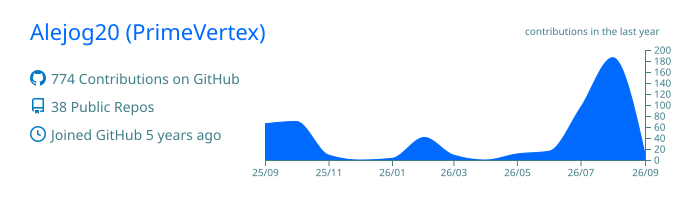
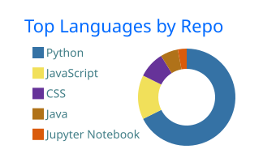

# Alejandro García
**Software Engineer · Python Automation & Data Systems**

Backend developer and data analyst based in Bogotá. I build Python automation, APIs, and data pipelines that cut manual work and keep reporting reliable.

  <a href="https://garcia-dev.co"><strong>🌐 garcia-dev.co</strong></a> &nbsp;·&nbsp;
  <a href="https://linkedin.com"><strong>LinkedIn</strong></a> &nbsp;·&nbsp;
  <a href="mailto:garciaalejandro2552@gmail.com"><strong>garciaalejandro2552@gmail.com</strong></a>

---

<strong>🇺🇸 English</strong>

 

### About Me

I work at the intersection of software development and business operations. With a degree in International Business and hands-on experience in backend engineering, I focus on automating repetitive financial workflows, integrating client data systems, and maintaining clean reporting pipelines.

* **Day-to-day work:** Python automation, EDI integrations, REST APIs, and SQL/Pandas data modeling.
* **Outside of work:** Photography, cinema, and spending time outdoors with family.

 

### Technical Toolkit

<table width="100%">
  <tr>
    <th width="50%" align="center">Backend & APIs</th>
    <th width="50%" align="center">Data & Analytics</th>
  </tr>
  <tr>
    <td align="center">
      <kbd>Python</kbd> &nbsp; <kbd>Java</kbd> &nbsp; <kbd>FastAPI</kbd> &nbsp; <kbd>Spring Boot</kbd> &nbsp; <kbd>Flask</kbd>
    </td>
    <td align="center">
      <kbd>Pandas</kbd> &nbsp; <kbd>NumPy</kbd> &nbsp; <kbd>SQL</kbd> &nbsp; <kbd>Scikit-learn</kbd> &nbsp; <kbd>PyTorch</kbd> &nbsp; <kbd>Power BI</kbd>
    </td>
  </tr>
  <tr>
    <th width="50%" align="center">Frontend</th>
    <th width="50%" align="center">Tools & Environment</th>
  </tr>
  <tr>
    <td align="center">
      <kbd>React</kbd> &nbsp; <kbd>TypeScript</kbd> &nbsp; <kbd>JavaScript</kbd> &nbsp; <kbd>HTML5</kbd> &nbsp; <kbd>CSS3</kbd>
    </td>
    <td align="center">
      <kbd>Git</kbd> &nbsp; <kbd>Linux</kbd> &nbsp; <kbd>Bash</kbd> &nbsp; <kbd>Selenium</kbd>
    </td>
  </tr>
</table>

 

### Featured Projects

<table width="100%">
  <tr>
    <td width="50%" valign="top">
      <h4>CSV Download Auto-Processor</h4>
      
Python tool that watches the Downloads folder, validates incoming CSV files with Pandas, extracts archives, and converts them into clean XLSX reports with proper error handling.

      
<code>Python</code> <code>Pandas</code> <code>Automation</code>

      <a href="https://github.com"><strong>View on GitHub &rarr;</strong></a>
    </td>
    <td width="50%" valign="top">
      <h4>Proyecto Samay — Full Stack Marketplace</h4>
      
Collaborative e-commerce platform built to connect Colombian indigenous artisans with buyers. Built with a Java and Spring backend and a Vanilla JS frontend.

      
<code>Java</code> <code>Spring</code> <code>JavaScript</code>

      <a href="https://github.com"><strong>View on GitHub &rarr;</strong></a>
    </td>
  </tr>
</table>

  <a href="https://garcia-dev.co">More projects and details at <strong>garcia-dev.co</strong> &rarr;</a>

---

<strong>🇪🇸 Español</strong>

 

### Sobre Mí

Trabajo en la intersección entre el desarrollo de software y las operaciones de negocio. Con formación en Negocios Internacionales y experiencia en desarrollo backend, me enfoco en automatizar flujos financieros repetitivos, integrar sistemas de datos de clientes y mantener pipelines de reportes confiables.

* **Enfoque diario:** Automatización en Python, integraciones EDI, APIs REST y modelado de datos con SQL y Pandas.
* **Fuera del código:** Fotografía, cine y tiempo al aire libre en familia.

 

### Stack Tecnológico

<table width="100%">
  <tr>
    <th width="50%" align="center">Backend y APIs</th>
    <th width="50%" align="center">Datos y Analítica</th>
  </tr>
  <tr>
    <td align="center">
      <kbd>Python</kbd> &nbsp; <kbd>Java</kbd> &nbsp; <kbd>FastAPI</kbd> &nbsp; <kbd>Spring Boot</kbd> &nbsp; <kbd>Flask</kbd>
    </td>
    <td align="center">
      <kbd>Pandas</kbd> &nbsp; <kbd>NumPy</kbd> &nbsp; <kbd>SQL</kbd> &nbsp; <kbd>Scikit-learn</kbd> &nbsp; <kbd>PyTorch</kbd> &nbsp; <kbd>Power BI</kbd>
    </td>
  </tr>
  <tr>
    <th width="50%" align="center">Frontend</th>
    <th width="50%" align="center">Herramientas y Entorno</th>
  </tr>
  <tr>
    <td align="center">
      <kbd>React</kbd> &nbsp; <kbd>TypeScript</kbd> &nbsp; <kbd>JavaScript</kbd> &nbsp; <kbd>HTML5</kbd> &nbsp; <kbd>CSS3</kbd>
    </td>
    <td align="center">
      <kbd>Git</kbd> &nbsp; <kbd>Linux</kbd> &nbsp; <kbd>Bash</kbd> &nbsp; <kbd>Selenium</kbd>
    </td>
  </tr>
</table>

 

### Proyectos Destacados

<table width="100%">
  <tr>
    <td width="50%" valign="top">
      <h4>Procesador Automático de Archivos CSV</h4>
      
Herramienta en Python que monitorea la carpeta de Descargas, valida archivos CSV con Pandas, extrae comprimidos y los convierte en reportes XLSX limpios con manejo de errores.

      
<code>Python</code> <code>Pandas</code> <code>Automatización</code>

      <a href="https://github.com"><strong>Ver en GitHub &rarr;</strong></a>
    </td>
    <td width="50%" valign="top">
      <h4>Proyecto Samay — Marketplace Full Stack</h4>
      
Plataforma colaborativa de comercio electrónico enfocada en productos de comunidades indígenas de Colombia. Desarrollada con backend en Java y Spring y frontend en Vanilla JS.

      
<code>Java</code> <code>Spring</code> <code>JavaScript</code>

      <a href="https://github.com"><strong>Ver en GitHub &rarr;</strong></a>
    </td>
  </tr>
</table>

  <a href="https://garcia-dev.co">Más proyectos y detalles en <strong>garcia-dev.co</strong> &rarr;</a>

---

### GitHub Statistics

  <table width="100%">
    <tr>
      <td width="50%" align="center" valign="middle">
        
      </td>
      <td width="50%" align="center" valign="middle">
        
      </td>
    </tr>
  </table>
   
  

